# parrotify-visualizers

Visualizers for [Parrotify](https://git.search-fire.net/parrotify)'s player (called Piratify up to
0.0.4). A Parrotify server
syncs this repo (Admin → Visualizer repos); every user then picks the visualizers they want and
which of them play in "random".

## Layout

```
index.json                                  generated: list of all visualizers (node tools/build-index.mjs)
order.json                                  order in the store, as <category>/<id>
visualizers/<category>/<id>/visualizer.js   the code
visualizers/<category>/<id>/meta.json       name, author, version, description, trails
visualizers/<category>/<id>/preview.png     still (node tools/previews.mjs <id>)
visualizers/<category>/<id>/preview.gif     animated preview (node tools/previews.mjs --gif <id>)
```

`<category>` is `2d` for Canvas 2D visualizers and `3d` for WebGL visualizers (`webgl: true`).
`<id>`: lower case letters, digits and dashes, at most 40 characters.

## Preset gallery

<!-- GALLERY:BEGIN -->

All 105 presets, animated with a synthetic spectrum. Click an image for the full-size GIF.

### 2D

| | | |
|---|---|---|
| [](visualizers/2d/mirror/preview.gif)<br>[Mirror](visualizers/2d/mirror/visualizer.js) | [](visualizers/2d/aurora/preview.gif)<br>[Aurora](visualizers/2d/aurora/visualizer.js) | [](visualizers/2d/cover-cuts/preview.gif)<br>[Cover Cuts](visualizers/2d/cover-cuts/visualizer.js) |
| [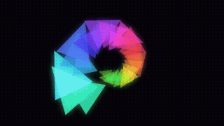](visualizers/2d/shatter/preview.gif)<br>[Shatter](visualizers/2d/shatter/visualizer.js) | [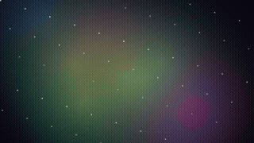](visualizers/2d/nebula/preview.gif)<br>[Nebula](visualizers/2d/nebula/visualizer.js) | [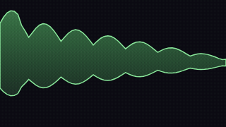](visualizers/2d/waves/preview.gif)<br>[Waves](visualizers/2d/waves/visualizer.js) |
| [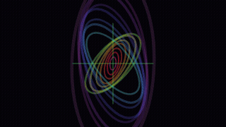](visualizers/2d/tunnel/preview.gif)<br>[Tunnel](visualizers/2d/tunnel/visualizer.js) | [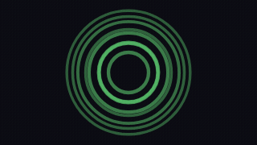](visualizers/2d/rings/preview.gif)<br>[Rings](visualizers/2d/rings/visualizer.js) | [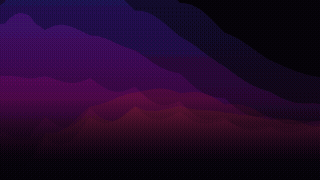](visualizers/2d/borealis/preview.gif)<br>[Borealis](visualizers/2d/borealis/visualizer.js) |
| [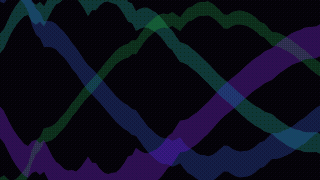](visualizers/2d/ribbon/preview.gif)<br>[Ribbon](visualizers/2d/ribbon/visualizer.js) | [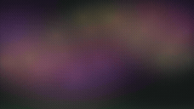](visualizers/2d/mist/preview.gif)<br>[Mist](visualizers/2d/mist/visualizer.js) | [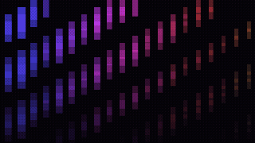](visualizers/2d/cascade/preview.gif)<br>[Cascade](visualizers/2d/cascade/visualizer.js) |
| [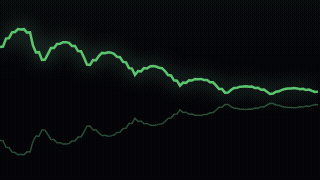](visualizers/2d/horizon/preview.gif)<br>[Horizon](visualizers/2d/horizon/visualizer.js) | [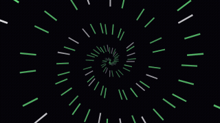](visualizers/2d/starfield/preview.gif)<br>[Starfield](visualizers/2d/starfield/visualizer.js) | [](visualizers/2d/kaleido/preview.gif)<br>[Kaleido](visualizers/2d/kaleido/visualizer.js) |
| [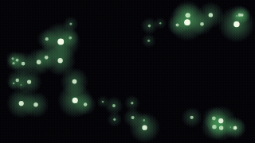](visualizers/2d/fireflies/preview.gif)<br>[Fireflies](visualizers/2d/fireflies/visualizer.js) | [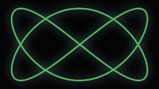](visualizers/2d/lissajous/preview.gif)<br>[Lissajous](visualizers/2d/lissajous/visualizer.js) | [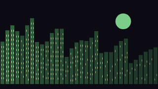](visualizers/2d/skyline/preview.gif)<br>[Skyline](visualizers/2d/skyline/visualizer.js) |
| [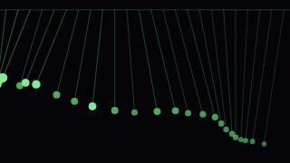](visualizers/2d/pendulum-wave/preview.gif)<br>[Pendulum Wave](visualizers/2d/pendulum-wave/visualizer.js) | [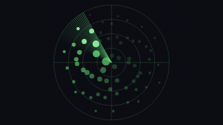](visualizers/2d/sonar/preview.gif)<br>[Sonar](visualizers/2d/sonar/visualizer.js) | [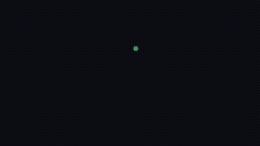](visualizers/2d/ink-drops/preview.gif)<br>[Ink Drops](visualizers/2d/ink-drops/visualizer.js) |
| [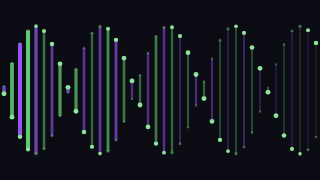](visualizers/2d/dna-helix/preview.gif)<br>[DNA Helix](visualizers/2d/dna-helix/visualizer.js) | [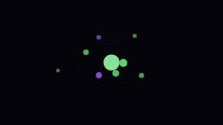](visualizers/2d/orbitals/preview.gif)<br>[Orbitals](visualizers/2d/orbitals/visualizer.js) | [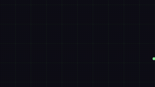](visualizers/2d/seismograph/preview.gif)<br>[Seismograph](visualizers/2d/seismograph/visualizer.js) |
| [](visualizers/2d/rainfall/preview.gif)<br>[Rainfall](visualizers/2d/rainfall/visualizer.js) | [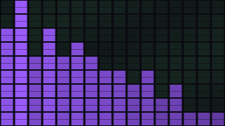](visualizers/2d/flip-tiles/preview.gif)<br>[Flip Tiles](visualizers/2d/flip-tiles/visualizer.js) | [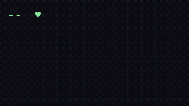](visualizers/2d/heartbeat/preview.gif)<br>[Heartbeat](visualizers/2d/heartbeat/visualizer.js) |
| [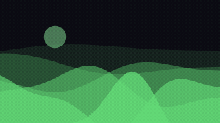](visualizers/2d/dunes/preview.gif)<br>[Dunes](visualizers/2d/dunes/visualizer.js) | [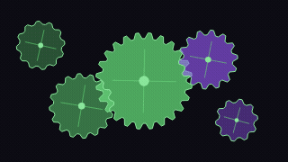](visualizers/2d/clockwork/preview.gif)<br>[Clockwork](visualizers/2d/clockwork/visualizer.js) | [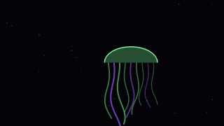](visualizers/2d/jellyfish/preview.gif)<br>[Jellyfish](visualizers/2d/jellyfish/visualizer.js) |
| [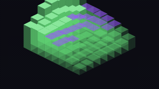](visualizers/2d/iso-city/preview.gif)<br>[Iso City](visualizers/2d/iso-city/visualizer.js) | [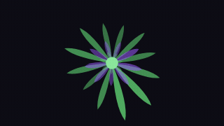](visualizers/2d/bloom/preview.gif)<br>[Bloom](visualizers/2d/bloom/visualizer.js) | [](visualizers/2d/lightning/preview.gif)<br>[Lightning](visualizers/2d/lightning/visualizer.js) |
| [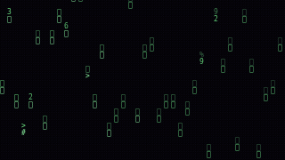](visualizers/2d/glyph-rain/preview.gif)<br>[Glyph Rain](visualizers/2d/glyph-rain/visualizer.js) | [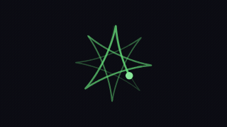](visualizers/2d/spirograph/preview.gif)<br>[Spirograph](visualizers/2d/spirograph/visualizer.js) | [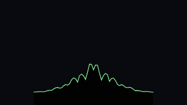](visualizers/2d/pulsar/preview.gif)<br>[Pulsar](visualizers/2d/pulsar/visualizer.js) |
| [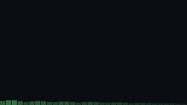](visualizers/2d/bubbles/preview.gif)<br>[Bubbles](visualizers/2d/bubbles/visualizer.js) | [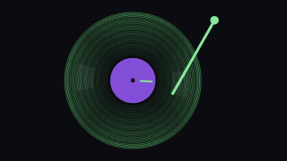](visualizers/2d/vinyl/preview.gif)<br>[Vinyl](visualizers/2d/vinyl/visualizer.js) | [](visualizers/2d/fireworks/preview.gif)<br>[Fireworks](visualizers/2d/fireworks/visualizer.js) |
| [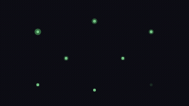](visualizers/2d/ripples/preview.gif)<br>[Ripples](visualizers/2d/ripples/visualizer.js) | [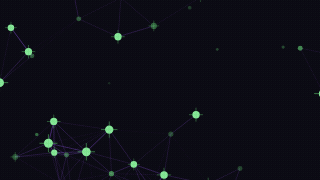](visualizers/2d/constellation/preview.gif)<br>[Constellation](visualizers/2d/constellation/visualizer.js) | [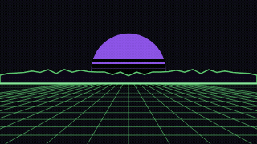](visualizers/2d/synthwave/preview.gif)<br>[Synthwave](visualizers/2d/synthwave/visualizer.js) |
| [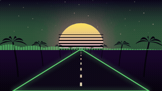](visualizers/2d/outrun/preview.gif)<br>[Outrun](visualizers/2d/outrun/visualizer.js) | [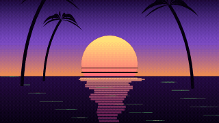](visualizers/2d/miami/preview.gif)<br>[Miami](visualizers/2d/miami/visualizer.js) | [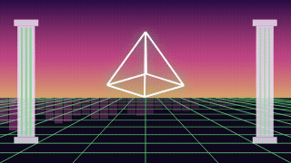](visualizers/2d/vaporwave/preview.gif)<br>[Vaporwave](visualizers/2d/vaporwave/visualizer.js) |
| [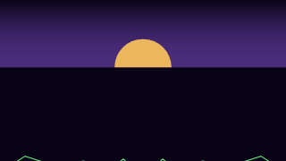](visualizers/2d/terrain/preview.gif)<br>[Terrain](visualizers/2d/terrain/visualizer.js) | [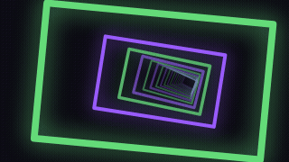](visualizers/2d/neon-tunnel/preview.gif)<br>[Neon Tunnel](visualizers/2d/neon-tunnel/visualizer.js) | [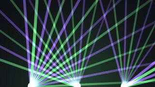](visualizers/2d/lasers/preview.gif)<br>[Lasers](visualizers/2d/lasers/visualizer.js) |
| [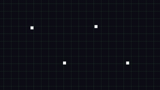](visualizers/2d/light-cycles/preview.gif)<br>[Light Cycles](visualizers/2d/light-cycles/visualizer.js) | [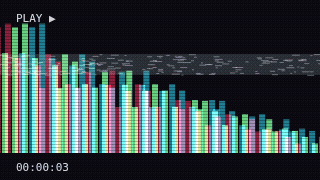](visualizers/2d/vhs/preview.gif)<br>[VHS](visualizers/2d/vhs/visualizer.js) | [](visualizers/2d/warp/preview.gif)<br>[Warp](visualizers/2d/warp/visualizer.js) |
| [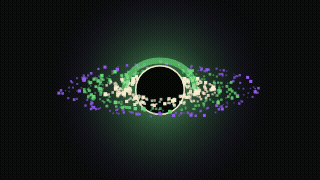](visualizers/2d/black-hole/preview.gif)<br>[Black Hole](visualizers/2d/black-hole/visualizer.js) | [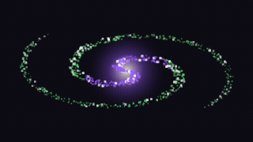](visualizers/2d/galaxy/preview.gif)<br>[Galaxy](visualizers/2d/galaxy/visualizer.js) | [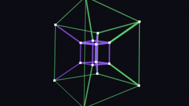](visualizers/2d/tesseract/preview.gif)<br>[Tesseract](visualizers/2d/tesseract/visualizer.js) |
| [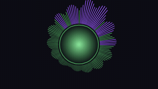](visualizers/2d/radial/preview.gif)<br>[Radial](visualizers/2d/radial/visualizer.js) | [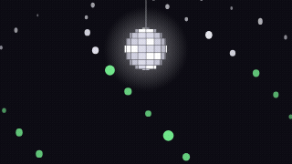](visualizers/2d/disco/preview.gif)<br>[Disco](visualizers/2d/disco/visualizer.js) | [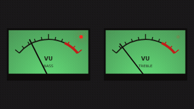](visualizers/2d/amplifier/preview.gif)<br>[Amplifier](visualizers/2d/amplifier/visualizer.js) |
| [](visualizers/2d/cassette/preview.gif)<br>[Cassette](visualizers/2d/cassette/visualizer.js) | [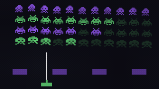](visualizers/2d/invaders/preview.gif)<br>[Invaders](visualizers/2d/invaders/visualizer.js) | [](visualizers/2d/copper-bars/preview.gif)<br>[Copper Bars](visualizers/2d/copper-bars/visualizer.js) |
| [](visualizers/2d/pixel-fire/preview.gif)<br>[Pixel Fire](visualizers/2d/pixel-fire/visualizer.js) | [](visualizers/2d/lava-lamp/preview.gif)<br>[Lava Lamp](visualizers/2d/lava-lamp/visualizer.js) | [](visualizers/2d/fractal-tree/preview.gif)<br>[Fractal Tree](visualizers/2d/fractal-tree/visualizer.js) |
| [](visualizers/2d/mandala/preview.gif)<br>[Mandala](visualizers/2d/mandala/visualizer.js) | [](visualizers/2d/peak-meter/preview.gif)<br>[Peak Meter](visualizers/2d/peak-meter/visualizer.js) | [](visualizers/2d/spectrogram/preview.gif)<br>[Spectrogram](visualizers/2d/spectrogram/visualizer.js) |
| [](visualizers/2d/alchemy/preview.gif)<br>[Alchemy](visualizers/2d/alchemy/visualizer.js) | [](visualizers/2d/battery/preview.gif)<br>[Battery](visualizers/2d/battery/visualizer.js) | [](visualizers/2d/plasma/preview.gif)<br>[Plasma](visualizers/2d/plasma/visualizer.js) |
| [](visualizers/2d/sparks/preview.gif)<br>[Sparks](visualizers/2d/sparks/visualizer.js) | [](visualizers/2d/vortex/preview.gif)<br>[Vortex](visualizers/2d/vortex/visualizer.js) | [](visualizers/2d/helix/preview.gif)<br>[Helix](visualizers/2d/helix/visualizer.js) |
| [](visualizers/2d/scope/preview.gif)<br>[Scope](visualizers/2d/scope/visualizer.js) | [](visualizers/2d/gridpulse/preview.gif)<br>[Grid Pulse](visualizers/2d/gridpulse/visualizer.js) | [](visualizers/2d/bars/preview.gif)<br>[Bars](visualizers/2d/bars/visualizer.js) |
| [](visualizers/2d/dots/preview.gif)<br>[Dots](visualizers/2d/dots/visualizer.js) |  |  |

### 3D / WebGL

| | | |
|---|---|---|
| [](visualizers/3d/sculpture/preview.gif)<br>[Sculpture](visualizers/3d/sculpture/visualizer.js) | [](visualizers/3d/hologram/preview.gif)<br>[Hologram](visualizers/3d/hologram/visualizer.js) | [](visualizers/3d/echo/preview.gif)<br>[Echo](visualizers/3d/echo/visualizer.js) |
| [](visualizers/3d/pillars/preview.gif)<br>[Pillars](visualizers/3d/pillars/visualizer.js) | [](visualizers/3d/aurora-3d/preview.gif)<br>[Aurora 3D](visualizers/3d/aurora-3d/visualizer.js) | [](visualizers/3d/chrome-mountains/preview.gif)<br>[Chrome Mountains](visualizers/3d/chrome-mountains/visualizer.js) |
| [](visualizers/3d/circuit-city/preview.gif)<br>[Circuit City](visualizers/3d/circuit-city/visualizer.js) | [](visualizers/3d/cosmic-dust/preview.gif)<br>[Cosmic Dust](visualizers/3d/cosmic-dust/visualizer.js) | [](visualizers/3d/crystal-cavern/preview.gif)<br>[Crystal Cavern](visualizers/3d/crystal-cavern/visualizer.js) |
| [](visualizers/3d/cube-vortex/preview.gif)<br>[Cube Vortex](visualizers/3d/cube-vortex/visualizer.js) | [](visualizers/3d/data-skyline/preview.gif)<br>[Data Skyline](visualizers/3d/data-skyline/visualizer.js) | [](visualizers/3d/diamond-core/preview.gif)<br>[Diamond Core](visualizers/3d/diamond-core/visualizer.js) |
| [](visualizers/3d/digital-city/preview.gif)<br>[Digital City](visualizers/3d/digital-city/visualizer.js) | [](visualizers/3d/geometric-tunnel/preview.gif)<br>[Geometric Tunnel](visualizers/3d/geometric-tunnel/visualizer.js) | [](visualizers/3d/grid-runner/preview.gif)<br>[Grid Runner](visualizers/3d/grid-runner/visualizer.js) |
| [](visualizers/3d/ice-fracture/preview.gif)<br>[Ice Fracture](visualizers/3d/ice-fracture/visualizer.js) | [](visualizers/3d/kaleido-sphere/preview.gif)<br>[Kaleido Sphere](visualizers/3d/kaleido-sphere/visualizer.js) | [](visualizers/3d/liquid-metal/preview.gif)<br>[Liquid Metal](visualizers/3d/liquid-metal/visualizer.js) |
| [](visualizers/3d/neon-crystals/preview.gif)<br>[Neon Crystals](visualizers/3d/neon-crystals/visualizer.js) | [](visualizers/3d/ocean-depths/preview.gif)<br>[Ocean Depths](visualizers/3d/ocean-depths/visualizer.js) | [](visualizers/3d/orbital-rings/preview.gif)<br>[Orbital Rings](visualizers/3d/orbital-rings/visualizer.js) |
| [](visualizers/3d/particle-nebula/preview.gif)<br>[Particle Nebula](visualizers/3d/particle-nebula/visualizer.js) | [](visualizers/3d/prism-temple/preview.gif)<br>[Prism Temple](visualizers/3d/prism-temple/visualizer.js) | [](visualizers/3d/skyscraper-pulse/preview.gif)<br>[Skyscraper Pulse](visualizers/3d/skyscraper-pulse/visualizer.js) |
| [](visualizers/3d/starfield-warp/preview.gif)<br>[Starfield Warp](visualizers/3d/starfield-warp/visualizer.js) | [](visualizers/3d/supernova/preview.gif)<br>[Supernova](visualizers/3d/supernova/visualizer.js) | [](visualizers/3d/synthwave-3d/preview.gif)<br>[Synthwave 3D](visualizers/3d/synthwave-3d/visualizer.js) |
| [](visualizers/3d/torus-beats/preview.gif)<br>[Torus Beats](visualizers/3d/torus-beats/visualizer.js) | [](visualizers/3d/wave-ribbon/preview.gif)<br>[Wave Ribbon](visualizers/3d/wave-ribbon/visualizer.js) |  |

<!-- GALLERY:END -->

## Writing a visualizer

A visualizer is plain JavaScript that calls `parrotify.register` once:

```js
parrotify.register({
  trails: false,        // true: the old frame fades out instead of being cleared (motion trails)
  color: '#ff6a00',     // optional: own default colour (else the user's choice, e.g. the UI complement)
  draw(ctx, f) {
    // ctx: CanvasRenderingContext2D, already scaled to CSS pixels, cleared (or faded) for you
    const barW = f.w / f.levels.length
    f.levels.forEach((v, i) => {
      ctx.fillStyle = `rgba(${f.rgb}, ${0.3 + v * 0.7})`
      ctx.fillRect(i * barW, f.h * (1 - v), barW - 1, f.h * v)
    })
  },
})
```

`parrotify.register` needs a server from 0.0.5 on; older (Piratify) servers only know
`piratify.register`, which newer servers still accept.

`draw` runs once per animation frame with `f`:

| field | meaning |
|---|---|
| `levels` | `Float32Array(64)`, 0..1, `levels[0]` bass … `levels[63]` treble |
| `w`, `h` | canvas size in CSS pixels |
| `time` | seconds (monotonic) |
| `bass`, `mid`, `high`, `energy` | averages of the levels, 0..1 |
| `rgb` | colour to draw in as `"r, g, b"` (use `rgba(${f.rgb}, a)`) |
| `soft` | lighter variant of that colour (CSS colour) |
| `accentRgb` | the UI accent as `"r, g, b"` |
| `playing` | whether music plays (levels fall to 0 when paused) |
| `cover` | the cover of the track as an `ImageBitmap` (512×512) or `null`; `ctx.drawImage(f.cover, …)` or `gl.texImage2D(…, f.cover)` (server 0.0.8 or newer) |
| `beat`, `beats` | a beat starts in this frame (bass jumping over its average of the last second); the number of beats so far (server 0.0.8 or newer) |

### WebGL

With `webgl: true` the visualizer gets a WebGL context (WebGL 2 where there is one, else WebGL 1)
instead of the 2D one, needs a server from 0.0.8 on, and draws all of the picture itself:

```js
parrotify.register({
  webgl: true,
  maxPixelRatio: 0.75, // optional: resolution of the canvas relative to CSS pixels (default 1)
  init(gl) { /* compile shaders, create buffers – once */ },
  draw(gl, f) { /* viewport is set to the canvas; f.pw, f.ph: its size in pixels */ },
})
```

A shader runs for every pixel; keep `maxPixelRatio` low for heavy ones (phones). See
`visualizers/3d/sculpture` (ray marching, beat-cut camera).

Keep it stateless where you can (derive motion from `time` and `levels`); module-level
variables are fine for state that has to persist between frames.

### What a visualizer can and cannot do

It runs in a sandbox: an `<iframe sandbox="allow-scripts">` page with a strict
Content-Security-Policy. It has a canvas and nothing else (plus the cover the player hands over) — no network (`fetch`, images,
WebSocket), no storage, no access to the player page or the user's login. Errors in `draw`
are caught; after 30 failing frames in a row the player falls back to another visualizer.

## Checks

```bash
npm install
node tools/build-index.mjs      # after every change (index.json pins the sha256 of each file)
node --test tools/test.mjs      # every visualizer registers and draws with finite numbers
npx playwright install chromium && node tools/previews.mjs <id>
```

A Parrotify server refuses a visualizer whose file does not match the `sha256` in `index.json`.

## Your own repo

Fork or copy this layout anywhere (Forgejo/Gitea, GitHub or any web server serving
`index.json`) and add its URL under Admin → Visualizer repos.

## Credits

3D models and other files used by visualizers, with author and licence: [`assets/CREDITS.md`](assets/CREDITS.md).
